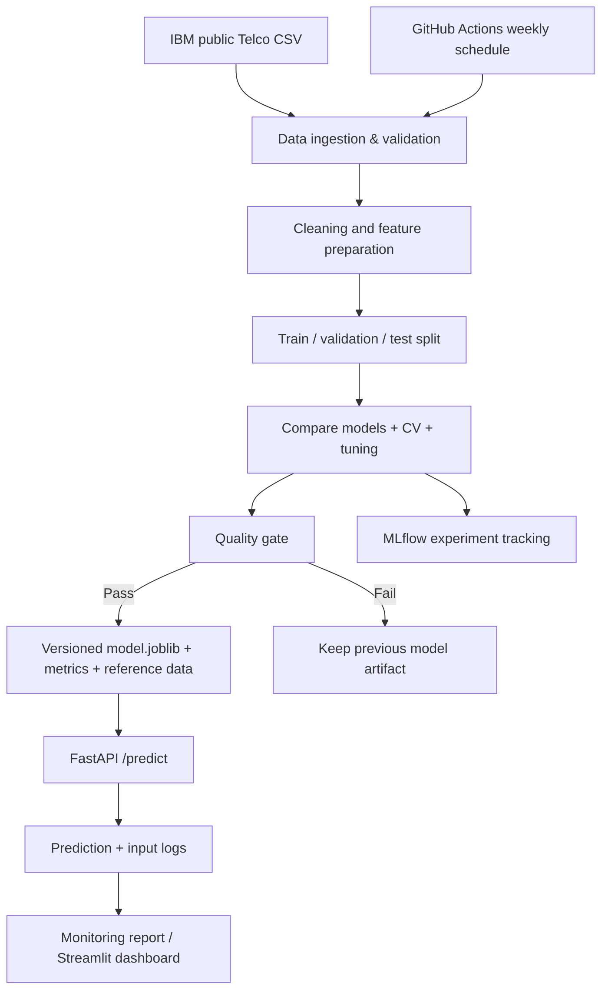

# Smart Customer Churn Prediction — End-to-End ML Capstone

A portfolio-ready ML system that estimates whether a telecom customer may churn. It includes automated data ingestion, preprocessing, model comparison/tuning, MLflow experiment tracking, FastAPI inference, Docker, monitoring logs, a Streamlit monitoring dashboard, and weekly scheduled retraining.

> Dataset note: This is IBM's public Telco Customer Churn **sample dataset** (7,043 customer records), representing a fictional telecom provider. It is useful for portfolio evaluation, not a production business claim.

## Architecture



## Components

- `src/pipeline.py`: downloads the source data if missing, validates/cleans it, compares Logistic Regression and Random Forest with stratified cross-validation, tunes the selected model, evaluates on a held-out test set, logs experiments to MLflow, and promotes a model only if ROC-AUC meets the quality threshold.
- `app/main.py`: FastAPI `/predict`, `/health`, `/metrics`; Pydantic input validation; logs request features and predictions.
- `dashboard.py`: Streamlit dashboard for request volume, prediction distribution, and simple numerical-feature drift checks.
- `.github/workflows/weekly-retrain.yml`: scheduled weekly pipeline run.
- `Dockerfile`: API container.

## Local setup (Windows + PyCharm)

Use Python 3.12 (recommended for broad package compatibility).

1. Extract the ZIP and open the `ML_Capstone_Churn_Prediction` folder in PyCharm.
2. Open **Settings → Project → Python Interpreter** and create/select a Python 3.12 virtual environment.
3. In PyCharm Terminal, run:

```powershell
python -m pip install --upgrade pip
pip install -r requirements.txt
python src/pipeline.py
```

The first run downloads the CSV into `data/raw/`, trains and evaluates the model, and writes artifacts under `models/` and `reports/`. MLflow runs are stored locally in `mlruns/`.

4. Start the API in one terminal:

```powershell
uvicorn app.main:app --reload
```

Open `http://127.0.0.1:8000/docs` for interactive API testing and `http://127.0.0.1:8000/health` for health status.

5. Start the dashboard in another terminal:

```powershell
streamlit run dashboard.py
```

Open the local dashboard URL printed in the terminal (usually `http://localhost:8501`).

6. Optional: open MLflow's experiment UI:

```powershell
mlflow ui --backend-store-uri ./mlruns
```

Then visit `http://127.0.0.1:5000`.

## Example API request

```bash
curl -X POST "http://127.0.0.1:8000/predict" ^
  -H "Content-Type: application/json" ^
  -d "{\"gender\":\"Female\",\"SeniorCitizen\":0,\"Partner\":\"Yes\",\"Dependents\":\"No\",\"tenure\":12,\"PhoneService\":\"Yes\",\"MultipleLines\":\"No\",\"InternetService\":\"DSL\",\"OnlineSecurity\":\"No\",\"OnlineBackup\":\"Yes\",\"DeviceProtection\":\"No\",\"TechSupport\":\"No\",\"StreamingTV\":\"No\",\"StreamingMovies\":\"No\",\"Contract\":\"Month-to-month\",\"PaperlessBilling\":\"Yes\",\"PaymentMethod\":\"Electronic check\",\"MonthlyCharges\":70.35,\"TotalCharges\":845.5}"
```

## Docker

Train locally first so `models/model.joblib` exists, then:

```powershell
docker build -t churn-capstone-api .
docker run --rm -p 8000:8000 -v "${PWD}/monitoring:/app/monitoring" churn-capstone-api
```

## Retraining schedule

GitHub Actions runs weekly. Push the repository to GitHub, then open **Actions** and enable workflows. The workflow retrains and uploads reports/artifacts. Scheduled workflows run from the default branch. The hosted workflow is a reproducible retraining job; it does not automatically replace a separately deployed web service unless you add a model registry/artifact deployment step.

## Model choice and quality gate

The pipeline compares Logistic Regression and Random Forest using stratified 3-fold cross-validation, then tunes the selected family on ROC-AUC. It evaluates the final candidate on a held-out test set. The default promotion gate is test ROC-AUC >= 0.70. This is a portfolio threshold, not a universal business threshold. The final choice is determined by measured CV ROC-AUC, not assumed in advance.

## Monitoring limitations

The dashboard monitors API traffic and compares numeric request features with the training reference using a basic two-sample KS test. This is a lightweight drift signal, not proof of model degradation. True production performance monitoring requires ground-truth churn outcomes to arrive later and be joined to predictions. The sample dataset is a static cross-sectional snapshot.

## Public deployment checklist

- Deploy the API service using the included Dockerfile on a platform that supports containers.
- Set the service start command to `uvicorn app.main:app --host 0.0.0.0 --port $PORT` if required by the platform.
- Confirm `/health` and `/docs` on the public URL.
- Deploy the dashboard as a separate Streamlit service or adapt it to read a shared persistent store. Local CSV logs are not automatically shared between separate hosted services.
- Replace all local URLs in your demo with the live URLs.
- Record a 3–5 minute demo showing `/health`, `/docs` → `/predict`, dashboard monitoring, and the model comparison/metrics.

## Dataset source

IBM Telco Customer Churn sample CSV:
https://raw.githubusercontent.com/IBM/telco-customer-churn-on-icp4d/master/data/Telco-Customer-Churn.csv
